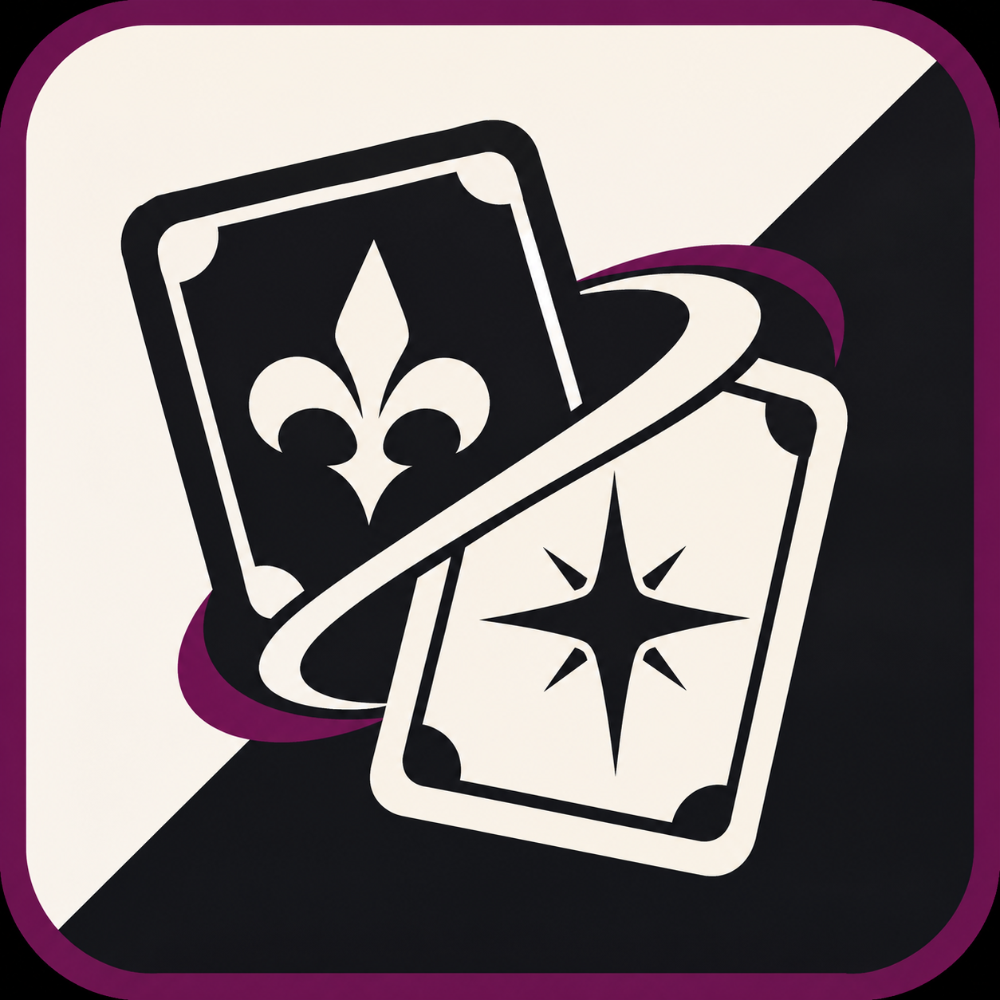

  

# Weiß Schwarz Collection

Weiß Schwarz Collection est une application Android pour suivre les cartes japonaises et anglaises de sa collection. Retrouvez vos franchises, repérez les variantes manquantes et suivez votre progression par série.

## Fonctionnalités

- **Catalogue japonais et anglais.** Recherchez une franchise par son titre, ses alias ou un code de carte. Importez les séries qui vous intéressent et actualisez le catalogue depuis l’application.
- **Collection illustrée.** Parcourez les franchises en liste ou en grille, avec leurs bannières et leur progression. Les cartes importées restent consultables hors ligne.
- **Suivi des cartes.** Filtrez les cartes possédées ou manquantes, modifiez les quantités par variante et ajoutez une carte manuellement avec une photo si besoin.
- **Export CSV.** Depuis une franchise ou une série, exportez les cartes possédées ou manquantes avec leur numéro et leur rareté.
- **Sauvegarde et restauration.** Enregistrez votre collection dans un fichier JSON pour la transférer vers un autre appareil.
- **Affichage.** Choisissez le français ou l’anglais, ainsi que le thème clair, sombre ou système.

## Prise en main

1. Ouvrez **Catalogue** et choisissez l’édition japonaise, anglaise ou les deux.
2. Sélectionnez une franchise, puis importez une série ou toutes celles qui vous intéressent.
3. Dans **Collection**, ouvrez une série et indiquez les cartes que vous possédez. Vous pouvez aussi sélectionner plusieurs cartes par un appui long.

L’application est disponible sous forme d’APK pour Android 6.0 ou version ultérieure. Dans **Réglages**, vous pouvez exporter une sauvegarde avant de changer d’appareil.

## À propos

Weiß Schwarz Collection est une application indépendante. Weiß Schwarz et les visuels des franchises appartiennent à leurs ayants droit respectifs.

Sources des cartes : [catalogue japonais officiel](https://ws-tcg.com/cardlist/) et [catalogue anglais officiel](https://en.ws-tcg.com/cardlist/).
